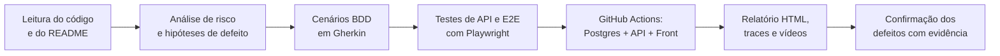

# QA – Plataforma Médica Mobilemed

  -22-red)   

Solução do teste técnico de QA da Mobilemed. O projeto testa a aplicação **real**: o GitHub Actions sobe o PostgreSQL 17, a API NestJS e o front Angular do desafio e roda **65 testes automatizados** de API e de interface com Playwright.

**Autor:** Haian Vilas Boas · [LinkedIn](https://www.linkedin.com/in/haian-vilas-boas-806647221/)

---

## Resumo executivo

- **65 testes** (58 de API e 7 de E2E): **43 passaram** e **22 falharam**. Cada falha é um defeito real, documentado.
- **14 defeitos encontrados:** 1 crítico, 5 altos, 5 médios e 3 baixos. Foram 11 confirmados na execução e 3 bloqueados pelo defeito crítico.
- **Defeito crítico:** o cadastro de exames responde **201 Created, mas não grava o exame**. Pela interface aparece a mensagem de sucesso, e o exame não existe.
- **Risco de LGPD:** as respostas de erro devolvem o **stack trace** da aplicação, numa plataforma com dados de saúde.

📄 [Resultados detalhados](docs/resultados.md) · 🐞 [Relatório de defeitos](docs/relatorio-de-bugs.md) · 🧭 [Plano de testes](docs/plano-de-testes.md) · 🥒 [Cenários BDD](features/)

---

## Resultados por área

| Projeto | Área | Testes | ✅ | ❌ |
|---|---|---:|---:|---:|
| API | Autenticação | 6 | 4 | 2 |
| API | Pacientes · cadastro | 12 | 7 | 5 |
| API | Pacientes · consulta e paginação | 9 | 6 | 3 |
| API | Exames · cadastro e modalidades DICOM | 20 | 16 | 4 |
| API | Exames · consulta | 3 | 2 | 1 |
| API | Idempotência e concorrência | 4 | 1 | 3 |
| API | Segurança e privacidade (LGPD) | 4 | 2 | 2 |
| E2E | Login | 3 | 3 | 0 |
| E2E | Pacientes e exames pela interface | 4 | 2 | 2 |
| | **Total** | **65** | **43** | **22** |

## Defeitos encontrados

| ID | Defeito | Severidade | Status |
|---|---|---|---|
| BUG01 | Cadastro de exame responde 201, mas não grava o exame | 🔴 Crítica | ✅ Confirmado |
| BUG02 | Busca por id de paciente e de exame retorna 500 | 🟠 Alta | ✅ Confirmado |
| BUG03 | Documento duplicado retorna 500 em vez de 409 | 🟠 Alta | ✅ Confirmado |
| BUG04 | Exame para paciente inexistente não é tratado | 🟠 Alta | ⏸️ Bloqueado pelo BUG01 |
| BUG05 | Condição de corrida na idempotência | 🟠 Alta | ⏸️ Bloqueado pelo BUG01 |
| BUG06 | Respostas de erro expõem stack trace | 🟠 Alta | ✅ Confirmado |
| BUG07 | API aceita CPF inválido (validação só no front) | 🟡 Média | ✅ Confirmado |
| BUG08 | Cliente consegue falsificar a auditoria (`createdBy`) | 🟡 Média | ✅ Confirmado |
| BUG09 | Front: editar um paciente substitui outro na lista | 🟡 Média | ✅ Confirmado |
| BUG10 | `GET /exames` ignora a paginação documentada | 🟡 Média | ⏸️ Mascarado pelo BUG01 |
| BUG13 | Campos acima do limite do banco retornam 500 | 🟡 Média | ✅ Confirmado |
| BUG11 | Página vazia retorna 404 e `pageSize` sem limite | 🟢 Baixa | ✅ Confirmado |
| BUG12 | Login inválido retorna 404 em vez de 401 | 🟢 Baixa | ✅ Confirmado |
| BUG14 | E-mail do usuário exposto na resposta do login | 🟢 Baixa | ✅ Confirmado |

Cada defeito tem passos para reproduzir, causa provável no código e sugestão de correção no [relatório](docs/relatorio-de-bugs.md).

---

## Como foi feito



1. **Análise estática do código** para levantar hipóteses de defeito antes de executar.
2. **Priorização por risco:** em plataforma de saúde, duplicidade de registros, integridade dos dados e vazamento de informação vêm primeiro.
3. **Técnicas:** partição de equivalência, valor-limite (tamanhos máximos do banco e paginação), tabela de decisão (idempotência) e teste de concorrência (10 requisições simultâneas com a mesma chave).
4. **Dados isolados:** CPFs válidos gerados a cada execução (com dígitos verificadores) e chaves de idempotência únicas.
5. **Os testes descrevem o comportamento esperado.** Um teste que falha é um defeito, não um teste quebrado.

## Estrutura

| Pasta | Conteúdo |
|---|---|
| `docs/` | Plano de testes, relatório de defeitos e resultados da execução |
| `features/` | Cenários BDD (Gherkin) de autenticação, pacientes e exames |
| `tests/api/` | Autenticação, pacientes, exames, idempotência e segurança |
| `tests/e2e/` | Interface com Page Objects: login, pacientes e exames |
| `tests/support/` | Geração de dados (CPF válido, chaves) e helpers de API |
| `.github/workflows/qa.yml` | Pipeline que sobe a aplicação e roda tudo |

## Evidências
Cada execução no [GitHub Actions](https://github.com/Dev-Haian/mobilemed-qa/actions) publica:
- **um resumo na própria página da execução**, com a tabela de testes;
- **o artefato `relatorio-qa`**, com o relatório HTML do Playwright, os traces, os vídeos das falhas de interface e os logs da API e do front.

## Como rodar localmente
Com a aplicação do desafio rodando (passos do README dela):

```bash
npm install
npx playwright install chromium
npm run test:api     # só API
npm run test:e2e     # só interface
npm run report       # abre o relatório HTML
```

Variáveis opcionais: `API_URL` (padrão `http://localhost:3000`) e `WEB_URL` (padrão `http://localhost:4200`).

## Ambiguidades levantadas
Listadas no [plano de testes](docs/plano-de-testes.md#7-ambiguidades-levantadas-para-alinhar-com-produto) (AMB01 a AMB06), com o comportamento que assumi em cada uma. Exemplo: o que deve acontecer quando a mesma `idempotencyKey` chega com dados diferentes?
